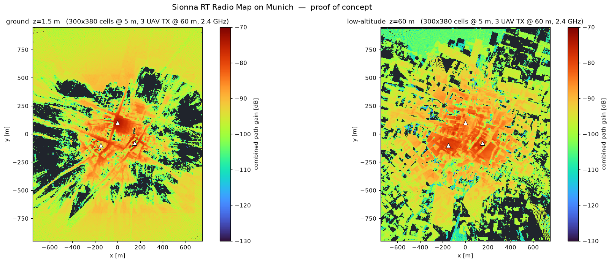

# Radio Map（电磁态势 / 频谱地图）调研

> 起因：师兄建议「可以 Vibe Coding 一个电磁态势或者电磁频谱的这个地图啊，叫 Radio Map」。
> 本文件是可行性调研，含**本机实测数据**，不是设计承诺。
> 调研日期：2026-10（本机 WSL Ubuntu + `.venv-rt`，sionna-rt 2.1.0 / Mitsuba 3.9.1，CPU LLVM 变体）

---

## 0. 一句话结论

**这个功能不用"从零做"——平台依赖的 sionna-rt 2.1.0 里自带 `RadioMapSolver`。**
实测：慕尼黑全城 1.5 km × 1.9 km、5 m 网格（11.4 万格）、3 个源，算一张图 **1.9 秒**；
同场景的常规 RT 路径仿真要 **21 秒**。**Radio map 比现有仿真便宜一个数量级。**

真正要写代码的是**配置项 + 一个 worker + 前端热力图**，物理那层是白送的。

---

## 1. 「Radio Map」到底指什么

这个词在文献里是个家族，口径必须分清，否则汇报时容易被问倒：

| 叫法 | 含义 | 与我们的关系 |
|---|---|---|
| Radio Map | 最泛：空间上的电磁环境描述 | 统称 |
| Radio Environment Map (REM) | 同上，偏认知无线电传统 | 统称 |
| **Path gain / Coverage map** | 每格一个路径增益（或 RSS） | **Sionna 直接给的就是这个** |
| **Spectrum map / Spectrum cartography** | 功率按「空间 × 频率」展开 | REM 的频谱维扩展，Sionna 不直接给 |
| **电磁态势（中文口径）** | 通常还含「谁覆盖谁」（association）与干扰（SINR / INR） | Sionna 给了 `sinr` 和 `tx_association` |

**一个必须说准的区分：**

- **Radio map 描述的是「信道/功率在空间上的分布」**，是**环境**的属性，与发什么波形无关；
- **平台现在的产出是时域 IQ**，是**某个点上**的信号。

两者是互补的两层，不是一回事。Radio map 可以当 IQ 仿真的空间先验；反过来，文献里更热的方向是**用稀疏采样 + 生成模型从少量实测重建整张 3D radio map**——后者才是「研究」，前者是「工具」。

**相关文献**（`web_search` 命中，供师兄交流用）：

- [Sionna 官方教程：Radio Maps](https://nvlabs.github.io/sionna/v1.2.2/rt/tutorials/Radio-Maps.html)
- [Sionna RT 技术报告 §4 Radio Map Solver](https://nvlabs.github.io/sionna/rt/tech-report/S4.html)
- [Generative Reconstruction of 3D Radio Maps for Low-Altitude Spectrum Monitoring（IEEE）](https://ieeexplore.ieee.org/document/11642109) —— **低空 + 3D + 生成重建，和课题最对口**
- [面向 5G 网络的低空频谱地图抗干扰测绘系统设计与实现](https://signal.ejournal.org.cn/cn/article/doi/10.12466/xhcl.2026.01.002)
- [ns-3: Novel Radio Environment Map](https://www.nsnam.org/wp-content/uploads/2021/wns3-session-3/wns3_2021_REM.pdf)

---

## 2. 平台现状：完全没有

在 `benchmark_v3/城市低空电磁信号仿真平台/` 下 grep：

```
RadioMap|radio_map|radio map|path_gain|PathGain
→ No matches found
```

平台只有「点对点」的信道求解（`sionna_backend.py` 里的 `PathSolver`），没有「面」的概念。

---

## 3. 依赖里已经有什么（本机 sionna-rt 2.1.0 实测导出）

```
['MeshRadioMap', 'PlanarRadioMap', 'RadioMap', 'RadioMapSolver',
 'radio_map_color_mapping', 'radio_map_solvers', 'radio_map_texture',
 'radio_map_to_emissive_shape']
```

### 3.1 求解器签名（`RadioMapSolver.__call__`）

```python
RadioMapSolver()(
    scene,
    center=None, orientation=None, size=None,     # 测量面三件套
    cell_size=[[10, 10]],                          # 默认 10 m 网格
    measurement_surface=None,                      # 给了就变成 MeshRadioMap
    precoding_vec=None,
    samples_per_tx=1000000,
    max_depth=3,
    los=True, specular_reflection=True, diffuse_reflection=False,
    refraction=True, diffraction=False,
    edge_diffraction=False, diffraction_lit_region=True,
    seed=42, rr_depth=-1, rr_prob=0.95, stop_threshold=None,
    check_cells_area=False, modified_scene=None,
) -> RadioMap
```

**三个坑（我踩过）：**

1. `center` / `orientation` / `size` **必须同时给或同时不给**，只给一个会抛
   `ValueError: If one of 'center', 'orientation', or 'size' is not None, then all of them must not be None.`
2. `size=None` 时自动覆盖整个场景（省事，但网格会被场景尺寸决定）。
3. **drjit 是惰性求值**：`solver(...)` 返回得飞快，真正的计算发生在你 `np.asarray(rm.path_gain)` 的那一刻。**计时必须在 `np.asarray` 之后停表**，否则会得出「0.02 秒算完全城」这种假结论（我第一版就上当了）。

### 3.2 每个 cell 是什么

求解器文档原文：

$$g_i = \frac{1}{|C_i|}\int_{C_i} |h(s)|^2 \, ds$$

即 **cell 内路径增益的平均值**，假设接收机是理想各向同性天线。单位是**线性功率增益**，不是 dB。

### 3.3 能取哪些指标

| 指标 | 含义 |
|---|---|
| `path_gain` | 路径增益，形状 `(num_tx, H, W)` |
| `rss` | 接收信号强度 |
| `sinr` | 信干噪比（含其它 TX 的干扰） |
| `tx_association` | **每个格点归哪个源最强** → 这就是「电磁态势」的归属图 |
| `transmitter_radio_map(metric, tx)` | 取单个源的图 |
| `cdf(metric, tx, bins)` | 指标的累积分布，出统计图用 |
| `sample_cells / sample_positions(...)` | **按指标反采样位置**（见 §7） |

### 3.4 两种测量面

- **`PlanarRadioMap`**：一块矩形平面网格（`center` + `orientation` + `size` + `cell_size`）。
  **改 `center` 的 z 就能出不同高度的切片**——低空电磁态势要的「30 m / 60 m / 120 m 走廊切片」天然支持。
- **`MeshRadioMap`**：`measurement_surface` 给任意 mesh，**每个三角形是一个 cell**。
  可以把图直接算在建筑立面上。

---

## 4. 实测代价（本机 WSL / LLVM CPU，慕尼黑场景，max_depth=3）

### 4.1 分辨率几乎不要钱

| 配置 | 耗时 | cells | path_gain 范围 |
|---|---|---|---|
| 10 m 网格 / 1 TX / 1e6 | **0.52 s** | 17,908 | −137.9 ~ −74.7 dB（中位 −97.1） |
| 10 m 网格 / **3 TX** / 1e6 | **0.66 s** | 17,908 | −137.9 ~ −74.4 dB |
| 5 m 网格 / 1 TX / 1e6 | **0.48 s** | 71,632 | −131.9 ~ −74.4 dB |
| **2 m 网格 / 1 TX / 1e6** | **0.49 s** | **445,014** | −123.9 ~ −73.5 dB |
| 10 m 网格 / 1 TX / 1e7 | 1.14 s | 17,908 | −142.3 ~ −74.7 dB |

**从 1.8 万格到 44.5 万格，耗时基本不变（0.48 ~ 0.52 s）。**
原因是求解器是**从发射源打射线往格子里落**，成本由射线数决定，不由格子数决定。

### 4.2 采样数是唯一的成本旋钮

1500 m × 1900 m @ 5 m = **114,000 格**，3 个源：

| 高度 | 1e6 采样 | 1e7 采样 | 1e8 采样 |
|---|---|---|---|
| z = 1.5 m（地面） | 0.63 s / 覆盖 47.3% | **1.87 s / 81.7%** | 15.40 s / 86.8% |
| z = 60 m（低空） | 0.52 s / 覆盖 50.1% | **1.93 s / 78.2%** | 15.48 s / 85.5% |

两个结论：

- **覆盖完整度是蒙特卡洛的**：采样越多，被射线命中的格子越多，图越"满"。
- **但覆盖率在 ~87% 就饱和了**，剩下 ~13% 是**真遮挡**（背阴面、楼内），不是采样不够。

**推荐默认：1e7 采样 / 5 m 网格 ≈ 2 秒，覆盖 ~80%。**

### 4.3 物理量级校验

自由空间路径增益 $|h|^2 = (\lambda / 4\pi d)^2$。2.4 GHz → λ = 0.125 m，d = 100 m：
$(0.125 / 1256.6)^2 = 9.9\times10^{-9}$ → **−80 dB**。

实测中位数 −88 ~ −97 dB（含建筑遮挡），**量级正确**。

### 4.4 对比：比现有仿真便宜一个数量级

| 任务 | 耗时 |
|---|---|
| 常规 RT 路径仿真（3 源 / 3 站 / 22 条路径） | 21.0 s（其中 15.7 s 是 `import`） |
| **Radio map（全城 11.4 万格 / 3 源 / 1e7 采样）** | **1.9 s** |

---

## 5. 概念验证图



`radiomap-demo.png`：慕尼黑，3 个无人机源 @ 60 m，2.4 GHz，5 m 网格，1e7 采样，max_depth=3。

- **左：地面 z = 1.5 m** —— 能看出街道峡谷的波导效应（沿街亮、背街暗），物理上很漂亮。
- **右：低空 z = 60 m** —— 与发射源同高度，建筑遮挡把图打得很碎。

两张图各 **~1.9 秒**算完。**这就是这个功能最终会长成的样子。**

---

## 6. 真正要写代码的部分

物理是白送的，工作量的 80% 在**接线和可视化**。

### 6.1 配置层（`src/cityrf/config.py`）

`Propagation` 里已有 `los / specular_reflection / diffuse_reflection / refraction / diffraction / max_depth / samples_per_src / scene / rt_variant`——**radio map 直接复用这一套开关**，物理口径自动和现有仿真一致（这点很重要，否则会被问「两张图的假设怎么不一样」）。

新增一个 `radio_map` 段即可：

```jsonc
"radio_map": {
  "enabled": true,
  "center": [0, 0, 60],        // 切片中心，z 就是高度
  "size": [1500, 1900],        // 覆盖范围
  "cell_size": 5.0,            // 网格分辨率
  "samples_per_tx": 10000000,  // 质量旋钮
  "metrics": ["path_gain", "rss", "sinr", "tx_association"]
}
```

### 6.2 计算层（新 worker）

照抄 `webui/worker.py` 的作业模式：独立子进程 → 算完写文件 → 打印 `COMPLETE`。
产物建议：

- `radiomap.npz`：各 metric 的 float32 数组 + 网格元数据（够小，11.4 万格 float32 ≈ 456 KB/metric）
- `radiomap.json`：网格参数 + 数值范围 + 用的传播开关（可复现、可审计，符合平台现有风格）
- 可选 `radiomap.png`：matplotlib 出图（`results.py` 已经在用 Agg + viridis）

### 6.3 接口层（`webui/server.py`）

现在只有 `POST /api/runs` 一条作业通道。加一条平行的：

```
POST /api/radio-map   → 起 worker，返回 jid
GET  /api/radio-map/{jid} → 取网格数据
```

静态资源走现成的 `app.mount("/assets", StaticFiles(...))`。

### 6.4 前端层（`webui/assets/map.js`）

`SceneMap` 现在已经有：地面 `PlaneGeometry`、建筑 `buildings` mesh、双相机（透视 + 正交）、2D 拖拽。
加一张热力图是最小改动：

1. 用一个 **`DataTexture`（或 `CanvasTexture`）** 贴上 colormap（turbo/viridis），铺在对应高度的平面上，`transparent: true` 叠在建筑之下或之上；
2. 加一个**高度滑块**（1.5 m ↔ 60 m ↔ 120 m），本质是重新请求一次或切换已算好的切片；
3. 加 **colorbar 图例**（DOM 覆盖层即可，不用 WebGL）；
4. 2D 正交模式下**鼠标悬停读格点数值**（现在 2D 模式已经有 pointer 拾取逻辑，复用它）。

### 6.5 工作量粗估

| 部分 | 量级 |
|---|---|
| 配置 + 校验 | 小（照抄 Propagation 的写法） |
| worker + API | 小（照抄 `run_job`） |
| 前端热力图 + 色标 + 高度滑块 | **主要工作量** |
| 文档 / README / 汇报材料 | 中 |

---

## 7. 这个功能对课题的价值（比「好看」更重要）

如果只是「多一张彩图」，那它就是个演示玩具。**它真正的价值在于 `sample_positions`。**

```python
sample_positions(num_pos, metric='path_gain',
                 min_val_db=None, max_val_db=None,
                 min_dist=None, max_dist=None,
                 tx_association=True, seed=1)
```

**这个函数能按指标反采样位置**——比如「给我 50 个路径增益在 −100 ~ −90 dB 之间的点，互相间距 ≥ 100 m」。

这直接接上你们的数据集生成：**现在的布站是手摆的，有了它就能按信道条件自动、可复现地撒点**，
让数据集在**空间维度上**有受控的多样性（而不是只在信噪比/调制维度上分层）。这条线写进汇报，
比「我们做了个热力图」高一个层次。

另外两个可以顺带讲的点：

- **`tx_association` 归属图** = 天然的「电磁态势」叙事，比单纯覆盖图更像"态势"；
- **多高度切片** 对应「低空」这个课题关键词，是 3D radio map 的雏形。

---

## 8. 诚实边界（汇报前必须自己想清楚）

1. **平面切片假设**。`PlanarRadioMap` 是一块**水平平面**，不是真 3D 体。多张切片 ≠ 连续 3D 场。
   （真要 3D 得用 `MeshRadioMap` 拼多个面，或者走文献里的生成重建路线。）
2. **蒙特卡洛覆盖**。图上有空洞，1e7 采样下约 20% 的格子没被命中。这是采样性质，不是"那里没信号"。
3. **这是功率的空间分布，不是频谱**。严格说 `path_gain` 图**没有频率维**，叫「频谱地图」不准确；
   叫「覆盖图 / 电磁态势图」更稳。要做真频谱地图需要多频点跑多次再拼。
4. **材料仍未实测校准**（和平台既有边界一致）：ITU 标准电波材质，不是实测反演。
5. **静态快照**：不含时间维、不含运动目标。与平台现有口径一致。
6. **与 IQ 仿真的一致性**：radio map 是各向同性接收假设 + cell 平均；IQ 仿真用的是具体天线与阵元。
   **两者数值不会严格相等**，汇报时别说"互相验证"。

---

## 9. 建议的推进方式

**A. 最小可用（先做出来看）**
全城一张 `path_gain` 图 + 一个高度滑块 + 色标。跑通配置 → worker → API → 前端整条链路。

**B. 完整一点（有汇报价值）**
加 `rss` / `sinr` / `tx_association` 三个 metric 切换 + 鼠标悬停读数 + 出 PNG。

**C. 研究向（能进论文）**
用 `sample_positions` 做**指标驱动的场景采样**，接进 `gen_dataset.py`，
证明「空间多样性可控」对下游检测/定位任务的影响。

---

## 附：本次调研的实验记录

所有实验脚本均为临时脚本，**已删除**；原始产物见 `radiomap-demo.png`。

| 编号 | 内容 |
|---|---|
| probe1 | 枚举 `sionna.rt` 里 radio map 相关导出与 `__init__` 签名 |
| probe2 | 取 `RadioMapSolver.__call__` 完整签名与文档；**踩坑**：误把 `PlanarRadioMap` 实例当 `center` 传进求解器 → `ValueError` |
| probe3 | 计时**错误**版（未强制求值）→ 得出「全城 0.02 s」的假结论 |
| probe4 | 修正计时（`np.asarray` 后停表）+ 分辨率 / 多源 / 采样数扫描 → §4.1 |
| probe5 | 出概念验证图 → §5 |
| probe6 | 采样数 vs 覆盖率扫描，判定「空洞是欠采样还是真遮挡」 → §4.2 |
